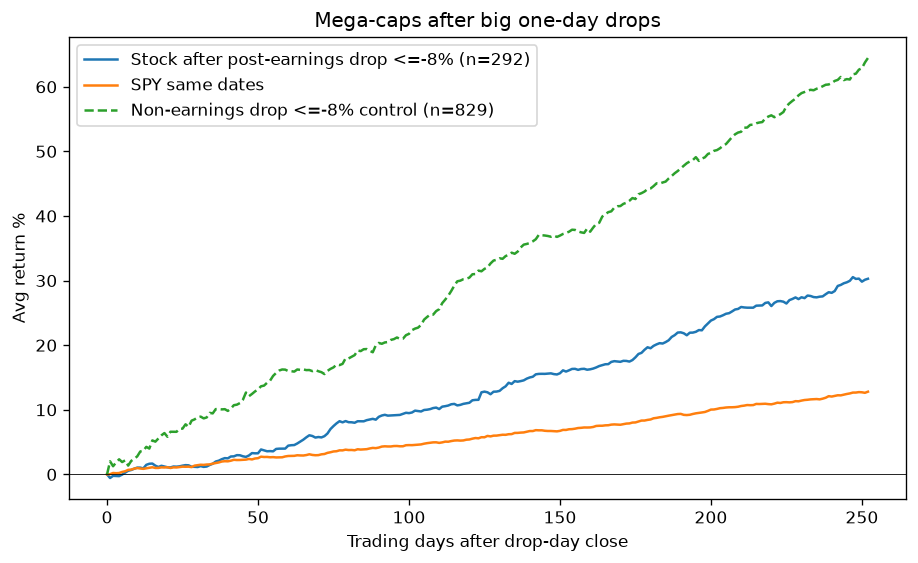
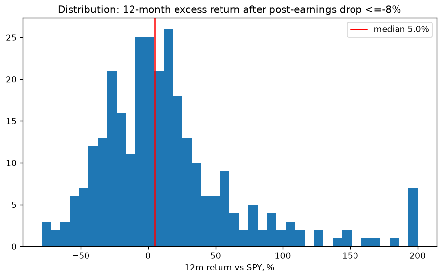

# Mega-cap post-earnings drops: buy the dip?

Research only, not advice. Trigger: GOOGL fell 13.1% on 2026-10-29 after Q3 earnings, its worst post-earnings day in this dataset (**outcome unknown**).

## Method
- 58 large US stocks (today's and former mega-caps, e.g. INTC, CSCO, IBM, GE, C, AIG, BA). yfinance adjusted prices, 1999 to 2026-10-29. Benchmarks: SPY and QQQ.
- Earnings dates come from yfinance `get_earnings_dates(limit=100)`, which covers about 2002 onward (ABBV from 2013). An after-close or intraday report reacts on the next session; a pre-market report reacts the same day.
- Events: reaction-day return ≤ -6%, -8% or -10%. A "record" drop is worse than every earlier post-earnings day for that stock, with at least 4 earlier reports.
- Forward returns are measured from the drop-day close (5/21/63/126/252 trading days). 95% CIs come from a bootstrap that resamples whole stocks.
- Cause proxy: EPS surprise below 0 counts as a miss. Otherwise the drop is attributed to guidance or other reasons.
- Control: drops of ≤ -8% on days that are not within 3 days of an earnings date.

## Results
| Set | n (stocks) | 1m vs SPY (mean / median) | 3m vs SPY | 12m raw mean | 12m vs SPY mean [95% CI] | 12m median vs SPY | 12m beat SPY |
|---|---|---|---|---|---|---|---|
| earnings<=-6% | 496 (56) | -0.4% / -0.9% | +1.8% | +27.2% | +13.9% [+6.6%, +22.1%] | +3.9% | 56% |
| earnings<=-8% | 292 (49) | -0.0% / -1.1% | +2.3% | +30.3% | +17.5% [+7.4%, +28.6%] | +5.0% | 57% |
| earnings<=-10% | 161 (38) | +0.4% / -1.7% | +2.3% | +34.6% | +21.8% [+7.1%, +38.3%] | +6.5% | 57% |
| record drop (<=-8%) | 78 (43) | -1.7% / -1.4% | -1.2% | +19.7% | +9.6% [-0.2%, +19.6%] | +4.0% | 56% |
| <=-8% pre-2015 | 153 (38) | +0.9% / -0.8% | +4.0% | +33.8% | +22.9% [+8.6%, +39.5%] | +9.7% | 61% |
| <=-8% 2015+ | 139 (39) | -1.0% / -1.6% | +0.6% | +26.4% | +11.6% [+2.7%, +20.6%] | +2.0% | 53% |
| <=-8% EPS miss | 107 (35) | +0.7% / +0.3% | +2.0% | +37.3% | +24.4% [+7.8%, +45.1%] | +4.7% | 55% |
| <=-8% EPS beat (guidance/other) | 183 (46) | -0.4% / -1.7% | +2.5% | +26.1% | +13.5% [+0.2%, +29.9%] | +4.7% | 57% |
| CONTROL non-earnings <=-8% | 829 (58) | +3.6% / +1.2% | +10.6% | +64.5% | +36.9% [+21.7%, +51.0%] | +15.0% | 64% |

### Entry timing (≤ -8% events, raw mean return)
| Horizon | Buy drop-day close | Buy next open | Staggered 1/3 d0,+5d,+21d |
|---|---|---|---|
| 1w | -0.1% | -0.1% |  |
| 1m | +1.0% | +1.0% | +0.7% |
| 3m | +5.3% | +5.3% | +5.0% |
| 6m | +13.3% | +13.3% | +12.8% |
| 12m | +30.3% | +30.3% | +29.7% |

### Case studies
| Ticker | Drop day | Drop | 1m | 3m | 12m | 12m vs SPY |
|---|---|---|---|---|---|---|
| META | 2022-02-03 | -26.4% | -21.2% | -12.4% | -21.7% | -15.0% |
| META | 2022-10-27 | -24.6% | +11.1% | +50.2% | +209.0% | +197.9% |
| NFLX | 2022-04-20 | -35.1% | -18.9% | -1.0% | +45.0% | +50.7% |
| NFLX | 2022-01-21 | -21.8% | -5.1% | -45.8% | -8.5% | -1.3% |
| AMZN | 2022-04-29 | -14.0% | -3.3% | +8.9% | -16.6% | -18.0% |
| AMZN | 2014-10-24 | -8.3% | +16.9% | +6.9% | +112.0% | +104.5% |
| MSFT | 2009-01-22 | -11.7% | +1.3% | +11.3% | +73.2% | +38.2% |
| INTC | 2024-08-02 | -26.1% | -5.8% | +0.8% | -4.4% | -24.6% |
| INTC | 2020-07-24 | -16.2% | -2.2% | +7.3% | +10.2% | -29.3% |
| GOOGL | 2019-04-30 | -7.5% | -6.5% | +2.4% | +11.9% | +10.2% |
| GOOGL | 2023-10-25 | -9.5% | +8.8% | +21.2% | +31.9% | -8.7% |
| NFLX | 2011-10-25 | -34.9% | -11.5% | +49.9% | -22.3% | -39.4% |
| AAPL | 2013-01-24 | -12.4% | -1.1% | -8.8% | +24.3% | +2.1% |
| GOOGL | 2006-02-01 | -7.1% | -5.9% | -1.9% | +19.8% | +5.0% |
| GOOGL | 2008-02-01 | -8.6% | -13.8% | +12.7% | -34.0% | +5.4% |
| GOOGL | 2008-07-18 | -9.8% | +3.5% | -26.7% | -10.6% | +11.8% |
| GOOGL | 2010-07-16 | -7.0% | +5.7% | +17.7% | +30.0% | +4.1% |
| GOOGL | 2011-04-15 | -8.3% | -0.0% | +12.1% | +14.9% | +7.3% |
| GOOGL | 2012-01-20 | -8.4% | +4.8% | +1.7% | +26.5% | +10.8% |
| GOOGL | 2022-10-26 | -9.1% | +2.7% | +4.7% | +28.7% | +19.5% |
| GOOGL | 2024-01-31 | -7.5% | -2.1% | +17.0% | +44.2% | +18.8% |
| GOOGL | 2025-02-05 | -7.3% | -9.1% | -20.8% | +69.4% | +53.8% |
| GOOGL | 2026-07-23 | -7.1% | +8.5% | +5.4% | outcome unknown | outcome unknown |
| GOOGL | 2026-10-29 | -13.1% | outcome unknown | outcome unknown | outcome unknown | outcome unknown |

## Charts

## Takeaways
- Over 1 week and 1 month, the stock typically keeps lagging SPY (median about -1%, and only 42-45% of events beat SPY). This matches post-earnings drift.
- Over 6-12 months the mean beats SPY, but the median edge is small (+2% to +5%). The mean is driven by big winners, the classic example being META in Oct 2022.
- Record drops are the weakest group: their 12m CI crosses zero.
- Post-2015 events are weaker than pre-2015 ones.
- Big drops without earnings news recovered far more strongly than post-earnings drops. Earnings drops carry real information.
- Entry timing barely matters. Staggering in did about the same as buying at the close.

## Caveats
- Survivorship bias: the universe is mostly today's winners and was not truly point-in-time top-50. This inflates the 12-month numbers.
- Events overlap (2008, 2022). Earnings dates before 2002 are missing.
- The EPS-surprise proxy is crude, and no revenue-deceleration test was done.

Reproduce: `python analyze.py`
